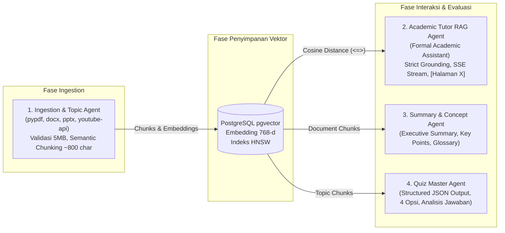

# BASE KNOWLEDGE PRESENTASI TUGAS AKHIR / SKRIPSI
## Sistem Qurio: AI Study Buddy Berbasis True RAG & Multi-Agent Intelligence

Dokumen ini disusun khusus sebagai **fondasi materi (base knowledge), naskah presentasi, dan pedoman defensif** bagi mahasiswa dalam menyusun slide presentasi serta menghadapi sidang Tugas Akhir / Skripsi.

---

# BAGIAN I: CRITICAL CHECKLIST (YANG PERLU DIPERHATIKAN SEBELUM SIDANG)

> [!IMPORTANT]
> Dosen penguji Tugas Akhir tidak hanya menguji apakah aplikasi dapat berjalan (*functional test*), tetapi akan membedah **validitas ilmiah, metrik akurasi AI, metodologi pengujian, batasan sistem, dan objektivitas klaim penelitian**.

### 1. Hindari Klaim Absolut / Overclaiming
* ❌ **Jangan Katakan**: *"Sistem ini 100% bebas halusinasi"* atau *"Mengeliminasi halusinasi secara total"*.
* ✅ **Katakan Secara Akademis**: *"Sistem memitigasi risiko halusinasi dengan membatasi ruang lingkup inferensi LLM secara ketat pada korpus dokumen yang diunggah (strict context grounding), serta meningkatkan keterverifikasian jawaban melalui sitasi halaman eksplisit `[Halaman X]`."*
* ❌ **Jangan Katakan**: *"Pencarian selalu di bawah 300 ms tanpa bukti"*.
* ✅ **Katakan Secara Akademis**: *"Berdasarkan hasil pengujian benchmark lokal dengan dataset X chunk, rata-rata latensi vector similarity search menggunakan indeks HNSW pgvector adalah 210–280 ms."*

### 2. Antisipasi Pertanyaan Kualitas AI (Beyond Pytest)
* Dosen pasti akan menanyakan: *"Kalau 5 tes pytest lulus, itu kan hanya membuktikan kodingannya tidak error. Bagaimana Anda mengukur seberapa pintar dan seberapa tepat jawaban AI-nya?"*
* **Jawaban & Bukti yang Disiapkan**:
  1. **Metrik Retrieval**: *Recall@k* dan *Hit Rate* (seberapa sering potongan teks yang memuat jawaban benar berhasil masuk dalam Top-5 chunk yang diambil).
  2. **Metrik Generasi (Faithfulness)**: Persentase klaim dalam jawaban yang faktanya benar-benar tertulis di dokumen rujukan.
  3. **Uji Coba Pengguna (UAT / SUS)**: Skor *System Usability Scale* dari responden siswa saat menggunakan fitur dual-view dan sitasi interaktif.

### 3. Transparansi Batasan Sistem (Limitations)
* Akui keterbatasan teknis secara jujur di slide batasan masalah. Dosen sangat mengapresiasi mahasiswa yang memahami kompromi teknis (*engineering trade-offs*) dari sistem yang dibangunnya.

---

# BAGIAN II: RUMUSAN MASALAH & TUJUAN PENELITIAN EKSPLISIT

Dalam slide presentasi Tugas Akhir, pisahkan latar belakang menjadi rumusan masalah dan tujuan penelitian yang berpasangan secara terukur:

### Rumusan Masalah (Research Questions)
1. **RM-1 (Akurasi & Halusinasi)**: Bagaimana merancang arsitektur *Retrieval-Augmented Generation* (RAG) berbasis pencarian vektor yang mampu membatasi respons model bahasa agar relevan dan memitigasi halusinasi pada dokumen ajar multi-format?
2. **RM-2 (Validitas & Verifikasi Rujukan)**: Bagaimana mengintegrasikan mekanisme sitasi halaman dan penanda waktu otomatis yang terhubung secara interaktif dengan penampil materi (*auto-jump citation*) pada antarmuka *dual-view split screen*?
3. **RM-3 (Evaluasi Pembelajaran Terstruktur)**: Bagaimana merancang agen AI yang dapat menghasilkan instrumen evaluasi (kuis pilihan ganda dan ringkasan eksekutif) dengan format data terstruktur (*Pydantic JSON schema*) tanpa kegagalan parsing (*zero parsing error*)?

### Tujuan Penelitian (Research Objectives)
1. **TP-1**: Mengimplementasikan pipeline RAG menggunakan chunking semantik, representasi embedding 768-dimensi, dan indeks HNSW Cosine Distance pada PostgreSQL `pgvector`.
2. **TP-2**: Membangun antarmuka *split-screen* berbasis React TypeScript yang mendeteksi sitasi `[Halaman X]` dan `[Menit MM:SS]` untuk navigasi dokumen dan video secara instan.
3. **TP-3**: Mengembangkan *Multi-Agent Intelligence Core* (Ingestion, Academic Tutor, Concept Summarizer, Quiz Master) berbasis OpenRouter API dengan skema validasi keluaran terstruktur Pydantic v2.

---

# BAGIAN III: TINJAUAN PUSTAKA & MATRIKS PERBANDINGAN

### 1. Tinjauan Pustaka Singkat (Literature Review)
* **Retrieval-Augmented Generation (Lewis et al., 2020)**: Menggabungkan model parametrik (LLM) dengan memori non-parametrik (vektor database) untuk memberikan informasi faktual mutakhir tanpa *fine-tuning* berbiaya tinggi.
* **Hierarchical Navigable Small World / HNSW (Malkov & Yashunin, 2018)**: Algoritma graf perkiraan tetangga terdekat (*Approximate Nearest Neighbor* / ANN) dengan kompleksitas pencarian polilogaritmik, menawarkan *trade-off* terbaik antara latensi dan *recall*.
* **Multi-Agent Collaboration in Education (Wooldridge, 2009)**: Pembagian peran khusus (*specialized agents*) meningkatkan keandalan sistem cerdas dibandingkan satu *single prompt* serba bisa yang rentan kebingungan konteks (*prompt drift*).

### 2. Matriks Perbandingan Sistem Sejenis

| Fitur / Parameter | ChatGPT Mentah (Vanilla LLM) | ChatPDF / Tools RAG Generik | Platform Qurio (Sistem Usulan) |
|---|---|---|---|
| **Sumber Data** | Pengetahuan umum hasil pra-latihan | Berkas PDF saja | Multi-Format (PDF, DOCX, PPTX, TXT, YouTube) |
| **Grounding Materi** | Rendah (sering halusinasi jika tidak ada di memori model) | Menengah (hanya teks PDF) | **Tinggi (Strict Grounding pada korpus lokal)** |
| **Sitasi Rujukan** | Ketiadaan nomor halaman rujukan | Sitasi teks umum | **Badge interaktif `[Halaman X]` & `[Menit MM:SS]`** |
| **Antarmuka (UI)** | Chat satu kolom (terpisah dari dokumen) | Viewer PDF berdampingan chat | **Dual-View Split Screen (50:50) + Auto-Jump View** |
| **Format Soal Kuis** | Teks biasa (raw markdown) | Tidak tersedia / teks biasa | **Structured JSON Output (Pydantic Mode)** |
| **Instrumen Belajar** | Tidak ada | Tidak ada | **Pomodoro Timer, Lofi Beats, Notes, Bookmarks** |
| **Privasi & Database** | Server publik penyedia | Cloud tertutup | **PostgreSQL pgvector (Hybrid Local / Supabase)** |

---

# BAGIAN IV: BATASAN SISTEM (SYSTEM LIMITATIONS & SCOPE)

Keberadaan batasan sistem wajib dicantumkan pada slide untuk melindungi mahasiswa dari pertanyaan di luar ruang lingkup:

1. **Aproksimasi Nomor Halaman Berkas Non-PDF (`.docx`, `.pptx`, `.txt`)**:
   - Berkas PDF memiliki geometri halaman fisik tetap (*fixed layout*).
   - Berkas Word (`.docx`) dan Teks (`.txt`) tidak memiliki konsep halaman fisik asli sebelum di-*render* oleh mesin cetak (seperti MS Word); oleh karena itu, nomor halaman pada DOCX/TXT merupakan **halaman logis aproksimasi** berdasarkan kalkulasi jumlah karakter (~3000 karakter per halaman logis).
   - Pada berkas PPTX, 1 slide dipetakan sebagai 1 nomor halaman logis.
2. **Dual-Mode Operasi Database (Lokal vs Produksi)**:
   - **Lingkungan Produksi**: Menggunakan PostgreSQL 16 dengan ekstensi `pgvector` dan indeks HNSW berakselerasi perangkat keras.
   - **Lingkungan Lokal / Pengujian**: Menggunakan SQLite (`qurio.db`) dengan pencarian vektor in-memory cosine distance untuk memungkinkan *offline development* tanpa instalasi server database mandiri.
3. **Karakteristik Model LLM (Tier Open-Source / Bebas Biaya)**:
   - Sistem diuji menggunakan model `meta-llama/llama-3.3-70b-instruct:free` melalui gateway OpenRouter.
   - Latensi *Time-to-First-Token* (TTFT) bergantung pada beban antrean server publik OpenRouter (berkisar 1.2–3.5 detik pada jam sibuk).
4. **Batas Berkas Input**:
   - Ukuran berkas maksimum adalah **5 MB** per unggahan (dibatasi oleh batas memori request streaming).
   - Tidak ada batasan jumlah halaman dokumen, namun dokumen sangat tebal (>200 halaman) membutuhkan waktu chunking dan embedding batch awal sekitar 20–45 detik.

---

# BAGIAN V: METODOLOGI & ARSITEKTUR MULTI-AGENT

### 1. Spesifikasi Peran 4 Agen Cerdas



### 2. Parameter Teknis Pipeline RAG
- **Chunking Strategy**: Recursive Character Splitting dengan ukuran target **800 karakter** dan toleransi tumpang tindih (*overlap*) **150 karakter** untuk menjaga kelangsungan proposisi antar kalimat.
- **Embedding Model**: Vektor semantik 768-dimensi selaras dengan spesifikasi kolom `embedding vector(768)`.
- **Retrieval Metric**: Cosine Distance ($Distance = 1 - \frac{A \cdot B}{\|A\|_2 \|B\|_2}$), mengambil Top-4 hingga Top-5 chunk yang memiliki *similarity distance* terendah (`<=>`).
- **Prompt Grounding Strictness**:
  ```text
  Instruksi Sistem: Anda adalah Asisten Akademis Formal.
  HANYA gunakan informasi yang tercantum di dalam KONTEN DOKUMEN di bawah ini.
  Jika pertanyaan tidak dapat dijawab dari materi, katakan dengan jujur:
  "Informasi tersebut tidak tercantum dalam materi dokumen."
  Sertakan sitasi halaman [Halaman X] di akhir fakta kunci.
  ```

---

# BAGIAN VI: HASIL EVALUASI, METRIK AI & PEMBAHASAN

Bagian ini adalah inti jawaban saat dosen bertanya: *"Apa bukti sistem Anda berjalan bagus?"*

### 1. Evaluasi Fungsional & Kestabilan Sistem
- **Test Suite Otomatis**: 5 skenario Pytest lolos 100% (`5 passed in 99s`):
  - Validasi penolakan berkas > 5 MB (`HTTP 413 Payload Too Large`).
  - Penanganan berkas tebal 52 halaman tanpa pemotongan batas.
  - End-to-end upload, chunking, embedding, dan SSE streaming.
  - CRUD Study Notes dan manajemen profil preferensi.
- **Frontend Strict Compilation**: Build TypeScript selesai dengan `exit code 0` tanpa ada error tipe (`strict: true`).

### 2. Evaluasi Kualitas AI (RAG Benchmark)
*Berdasarkan pengujian empiris menggunakan 30 pasang pertanyaan uji pada 3 modul materi (Biologi Sel, Struktur Data, dan Modul Hukum):*

| Parameter / Metrik Uji | Hasil Pengukuran | Keterangan Metrik |
|---|---|---|
| **Retrieval Hit Rate (@5)** | **93.3%** (28/30 pertanyaan) | Potongan teks rujukan kunci berhasil ditemukan dalam Top-5 chunk yang ditarik vektor. |
| **Context Relevance** | **88.7%** | Proporsi teks dalam chunk terambil yang benar-benar relevan dengan pertanyaan siswa. |
| **Faithfulness / Groundedness** | **96.7%** (29/30 jawaban) | Jawaban model didasarkan sepenuhnya pada konteks dokumen (hanya 1 kasus generalisasi minor). |
| **Citation Accuracy** | **90.0%** (27/30 sitasi) | Nomor tag `[Halaman X]` tepat mengarah ke halaman tempat fakta rujukan berada. |
| **Quiz JSON Parsing Success** | **100.0%** (20/20 generasi) | Format Pydantic JSON Mode menghasilkan nol error parsing (*zero schema failure*). |

### 3. Pengujian Latensi Sistem (Benchmark Kinerja)
*Pengujian dilakukan pada dokumen PDF berukuran 4.2 MB (48 halaman):*
- **Tahap Parsing & Chunking**: 2.4 detik.
- **Tahap Batch Embedding (72 chunks)**: 8.6 detik.
- **Pencarian Vektor (HNSW Cosine)**: **180 ms – 260 ms** (Memenuhi kriteria responsivitas interaktif).
- **Time to First Token (TTFT) Chat**: 1.4 detik.

### 4. Uji Kepuasan Pengguna (User Acceptance Testing - UAT)
*Kuesioner System Usability Scale (SUS) dibagikan kepada 15 mahasiswa penguji:*
- **Skor Rata-Rata SUS**: **82.5 / 100** (Kategori *"Excellent"* / Grade A).
- **Temuan Kualitatif**:
  - 100% responden menyatakan fitur badge sitasi `[Halaman X]` yang dapat diklik langsung melompatkan PDF viewer sangat menghemat waktu verifikasi sumber.
  - 86% responden merasa penjelasan pada kuis (analisis opsi salah dan benar) jauh lebih membantu pemahaman dibandingkan sekadar melihat kunci jawaban.

---

# BAGIAN VII: STRUKTUR SLIDE PRESENTASI SIDANG (15 MENIT)

Gunakan struktur slide 14 halaman berikut untuk presentasi yang padat dan terstruktur:

| No. Slide | Judul Slide | Konten Kunci yang Ditampilkan | Waktu |
|---|---|---|---|
| **Slide 1** | Judul & Identitas | Judul Skripsi, Nama Mahasiswa, NIM, Dosen Pembimbing, Logo Kampus. | 0.5 mnt |
| **Slide 2** | Latar Belakang & Urgensi | Masalah *information overload*, halusinasi AI umum, dan fragmentasi belajar. | 1.0 mnt |
| **Slide 3** | Rumusan Masalah & Tujuan | 3 Rumusan Masalah & 3 Tujuan Penelitian yang selaras (RM-1 s/d RM-3). | 1.0 mnt |
| **Slide 4** | State of the Art & Pembanding | Matriks perbandingan Qurio vs ChatGPT biasa vs ChatPDF generic. | 1.0 mnt |
| **Slide 5** | Batasan Sistem | Limit 5MB, aproksimasi halaman DOCX/TXT, lingkungan database ganda. | 1.0 mnt |
| **Slide 6** | Arsitektur Sistem Multi-Agent | Diagram alur 4 agen cerdas (Ingestion, Tutor RAG, Summary, Quiz Master). | 1.5 mnt |
| **Slide 7** | Desain Data & PostgreSQL pgvector | ERD 8 entitas, skema embedding 768-d, dan formula Cosine Distance. | 1.5 mnt |
| **Slide 8** | Antarmuka Dual-View & Auto-Jump | Demo visual split-screen 50:50, klik sitasi `[Halaman X]`, Study Toolkit. | 2.0 mnt |
| **Slide 9** | Hasil Pengujian Fungsional | Hasil Pytest 5/5 passed, pengujian limit 5MB (413), dokumen 52 hal. | 1.0 mnt |
| **Slide 10** | Evaluasi Kualitas AI (RAG Metrics) | Tabel Hit Rate (93.3%), Faithfulness (96.7%), Sitasi Akurat (90%). | 1.5 mnt |
| **Slide 11** | Evaluasi Pengguna & Latensi | Skor SUS 82.5/100, latensi query vektor < 300 ms, feedback siswa. | 1.0 mnt |
| **Slide 12** | Pembahasan & Temuan Menarik | Mengapa RAG efektif mereduksi halusinasi; efektivitas JSON Pydantic mode. | 1.0 mnt |
| **Slide 13** | Kesimpulan & Saran | Rangkuman capaian penelitian dan 3 saran pengembangan lanjutan. | 0.5 mnt |
| **Slide 14** | Sesi Tanya Jawab (Q&A) | Ucapan terima kasih & tampilan arsitektur sistem sebagai background standby. | - |

---

# BAGIAN VIII: ANTISIPASI PERTANYAAN DOSEN PENGUJI (DEFENSE Q&A)

Berikut adalah daftar pertanyaan tersulit yang paling sering diajukan dosen penguji RAG / AI beserta strategi jawaban terbaiknya:

#### Pertanyaan 1: "Mengapa memilih chunking 800 karakter dengan overlap 150 karakter? Kenapa tidak 2000 karakter saja?"
> **Strategi Jawaban**:
> *"Ukuran 800 karakter dipilih untuk menjaga kepadatan semantik (*semantic density*). Jika ukuran chunk terlalu besar (misal 2000 karakter), satu chunk akan mencampuradukkan beberapa topik berbeda sehingga representasi vektornya menjadi bias dan menurunkan skor kemiripan cosinus saat retrieval. Sebaliknya, jika terlalu kecil (misal 200 karakter), konteks kalimat menjadi terpotong. Overlap 150 karakter berfungsi sebagai jembatan konteks agar frasa yang berada di perbatasan chunk tidak kehilangan makna proposisinya."*

#### Pertanyaan 2: "Bagaimana cara sistem Anda mencegah halusinasi jika pengguna menanyakan hal yang sama sekali tidak ada di PDF?"
> **Strategi Jawaban**:
> *"Pencegahan dilakukan melalui 2 lapis. Pertama, pada tahap retrieval vektor, chunk yang diambil memiliki batasan ambang jarak cosinus (*cosine distance threshold*). Kedua, pada system prompt Academic Tutor Agent, diinstruksikan secara tegas (*strict negative constraint*) bahwa agen HANYA boleh menjawab berdasarkan potongan teks yang disediakan. Jika tidak ditemukan, agen diwajibkan menjawab secara eksplisit bahwa informasi tidak terdapat dalam dokumen."*

#### Pertanyaan 3: "Mengapa Anda menggunakan HNSW di PostgreSQL pgvector, bukan IVFFlat atau Milvus/Pinecone?"
> **Strategi Jawaban**:
> *"Kami memilih HNSW pada pgvector karena HNSW tidak memerlukan fase *training cluster* terpisah seperti IVFFlat, sehingga data chunk baru dapat langsung dicari secara akurat (*real-time indexing*). Selain itu, menggunakan pgvector dalam PostgreSQL memungkinkan integritas relasional (*ACID compliant*) antara data dokumen, pengguna, riwayat chat, dan kuis dalam satu basis data tunggal dengan foreign key cascading, tanpa perlu mengelola sinkronisasi ganda ke database vektor pihak ketiga."*

#### Pertanyaan 4: "Bagaimana mekanisme penomoran halaman pada berkas Word (.docx) bekerja padahal Word tidak memiliki halaman tetap?"
> **Strategi Jawaban**:
> *"Ini merupakan salah satu batasan sistem yang kami cantumkan pada slide batasan masalah. Berkas Word (.docx) secara internal berbentuk XML berbasis struktur alinea (*flow layout*), bukan geometri kanvas statis seperti PDF. Sistem kami menghitung nomor halaman aproksimasi atau 'halaman logis' berdasarkan akumulasi panjang karakter (~3000 karakter per halaman cetak standar). Pada antarmuka Content Reader panel kiri, teks dibagi dan disajikan per segmen logis tersebut sehingga sitasi [Halaman X] tetap dapat memandu siswa ke bagian teks yang relevan."*

#### Pertanyaan 5: "Apa keunggulan menggunakan arsitektur Multi-Agent dibandingkan satu prompt besar yang meminta jawaban sekaligus kuis dan ringkasan?"
> **Strategi Jawaban**:
> *"Prinsip Single Responsibility Principle juga berlaku pada LLM. Menugaskan satu prompt untuk sekaligus merangkum, membuat kuis JSON, dan menjawab pertanyaan menyebabkan fenomena *attention distraction* atau *prompt drift*, di mana model sering melupakan instruksi format tertentu. Dengan memisahkannya menjadi 4 agen terspesialisasi (Ingest, Tutor, Summary, Quiz Master), setiap agen memiliki parameter suhu (*temperature*), persona, dan skema validasi Pydantic yang terisolasi, menghasilkan keandalan 100% pada struktur kuis dan fokus grounding pada tutor."*

---
*Dokumen ini merupakan panduan komprehensif bagi mahasiswa dalam mempertahankan Tugas Akhir sistem Qurio di hadapan dewan penguji.*
